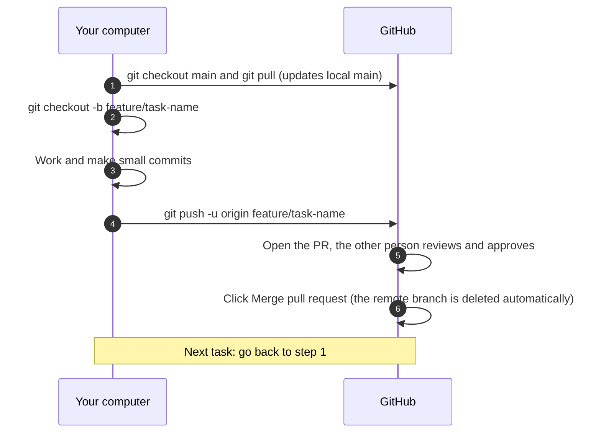

# Midware: Git and GitHub Guide (Two-Person Team Workflow)

## 1. Purpose

This document defines how Diego and Syed use Git and GitHub on the Midware project. The goal is for both of us to work in the same repository at the same time without overwriting each other's work, without breaking `main`, and with a history that is easy to read.

---

## 2. Golden rules

1. `main` is always stable. Nobody commits directly to it.
2. All work happens on its own branch, created from an up-to-date `main`.
3. Each branch has a single purpose. If another topic comes up, create another branch.
4. Every change reaches `main` through a Pull Request (PR), reviewed by the other person on the team.
5. Before starting any work, always update your local `main` (`git pull`).
6. Branches are short-lived: the longer a branch stays open, the higher the chance of conflicts.
7. Never use `git push --force` on a shared branch.
8. Never commit secrets (API keys, passwords, Meta or Resend tokens, `.env` files). Use `.gitignore` and environment variables.

---

## 3. Branch naming convention

Adopting clear branch naming conventions makes it easier to organize work and understand the purpose of each branch:

| Type | Prefix | Example |
|---|---|---|
| Feature | `feature/` | `feature/login-screen` |
| Fix | `fix/` | `fix/empty-password-bug` |
| Refactoring | `refactor/` | `refactor/password-generator` |
| Documentation | `docs/` | `docs/update-readme` |
| Tests | `test/` | `test/unit-user-service` |
| Infrastructure | `chore/` | `chore/update-dependencies` |

Rules for the name:

1. All lowercase, words separated by hyphens.
2. No spaces, accents or special characters.
3. Who created the branch is already visible on GitHub (author of the commits and of the PR), so it does not need to be in the name.

---

## 4. Commit message convention

We use the Conventional Commits standard, with the same types as the branch prefixes:

```
<type>: <short description in the imperative mood>
```

Examples:

```
feat: add batch endpoint for recipients
fix: reject empty password on tenant creation
refactor: extract key generation to its own service
docs: update README with run instructions
test: cover vatNumber validation
chore: update Pomelo MySQL package
```

Rules:

1. One commit, one idea. Small and frequent commits.
2. First line with at most 72 characters.
3. Never commit code that does not compile.

---

## 5. Daily workflow (from branch to merge)

The diagram shows the cycle of one person working. Diego and Syed follow exactly the same workflow, each on their own branch.



### 5.1 Step by step (6 steps)

The same 6 steps as the diagram, with the commands. It applies equally to Diego and Syed. Replace `task-name` with the name of your task, following the convention in section 3.

**Step 1. Update your local main** (Your computer, pulling from GitHub)

```bash
git checkout main
git pull
```

**Step 2. Create the task branch** (Your computer)

```bash
git checkout -b feature/task-name
```

**Step 3. Work and make small commits** (Your computer)

```bash
git status
git add <files>
git commit -m "feat: add batch endpoint for recipients"
```

Repeat `git add` and `git commit` as many times as needed while you work.

**Step 4. Publish the branch to GitHub** (Your computer to GitHub)

```bash
git push -u origin feature/task-name
```

**Step 5. Open the Pull Request and ask for a review** (GitHub, on the website)

No command needed. On GitHub, open a PR from your branch to `main`, fill in the description and wait for the other person on the team to review and approve it.

**Step 6. Merge the PR** (GitHub, on the website)

No command needed. Once the PR is approved, click the PR merge button. The remote branch is deleted automatically, as long as the Automatically delete head branches option is enabled in the repository.

Next task: go back to step 1.

---

## 6. Avoiding conflicts

A conflict happens when two people change the same lines of the same file. It cannot be eliminated 100%, but it can be greatly reduced.

### 6.1 Precautions

| Precaution | How to apply it |
|---|---|
| Agree on who touches what | Before starting, tell the other person which file or folder you will change (a quick message or a GitHub issue). |
| Short-lived branches | Open the PR within a few days at most. A long-lived branch accumulates divergence. |
| Update your branch often | At least once a day, bring `main` into your branch (section 6.2). |
| Be careful with shared files | Files that both of us tend to touch (`README.md`, `Program.cs`, configuration files, `.csproj`) deserve a heads-up. Change only what is necessary and never reformat the whole file. |
| Do not reformat someone else's code | Avoid changing indentation, `using` order or renaming files without agreeing first. These adjustments become a separate PR (`chore/` or `refactor/`). |
| Small commits | They make conflicts easier to resolve and the history easier to understand. |
| Generated files stay out of Git | `bin/`, `obj/`, `.env` and similar files go in `.gitignore`. |
| Never work on local `main` | If you committed to `main` by mistake, tell the other person before any push. |

### 6.2 How to bring main into your branch

Inside your working branch, with everything committed:

```
git fetch origin
git merge origin/main
```

If conflicts appear, Git lists the files. Open each one, look for the markers `<<<<<<<`, `=======` and `>>>>>>>`, choose the final text, remove the markers, then:

```
git add <resolved-file>
git commit
```

To give up halfway and go back to the previous state: `git merge --abort`.

Team decision: we use `merge` (not `rebase`) to update the branch, because it is safer for people who are starting out and it does not rewrite history.

### 6.3 What never to do to "resolve" a conflict

1. Never delete the other person's work just to make the conflict disappear.
2. Never use `git push --force` to force your version.
3. Never resolve a conflict in a file you do not understand without asking the author of the other change.

---

## 7. Command reference

All the commands of the full cycle, in the order of use:

```
# 1. Start: update main and create the branch
git checkout main
git pull
git checkout -b feature/batch-endpoint

# 2. Work: see what changed and commit
git status
git add <files>
git commit -m "feat: add batch endpoint for recipients"

# 3. Keep the branch up to date with main (do this at least once a day)
git fetch origin
git merge origin/main

# 4. Publish the branch
git push -u origin feature/batch-endpoint

# 5. After the PR is merged: clean up
git checkout main
git pull
git branch -d feature/batch-endpoint
git fetch --prune
```

Useful commands to find your bearings:

```
git branch                 # lists local branches and shows the current one
git log --oneline --graph  # short history in tree format
git diff                   # changes not yet committed
git merge --abort          # cancels a merge with conflicts
```
