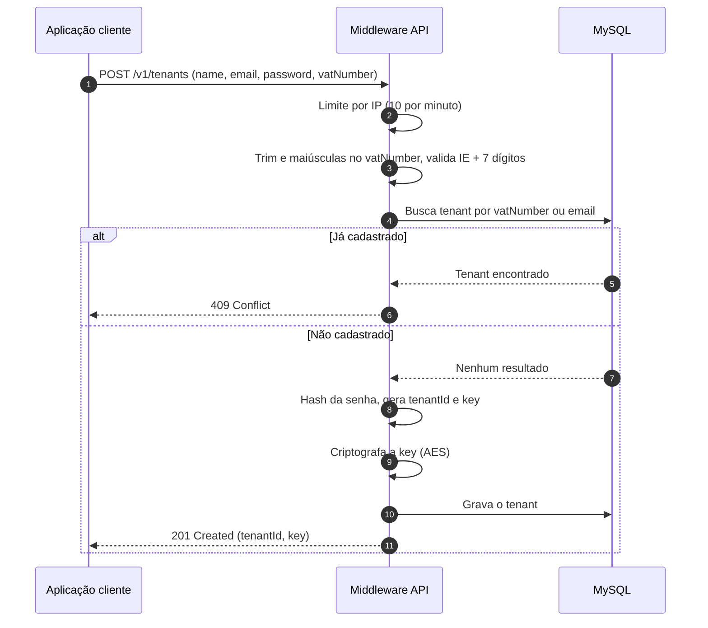
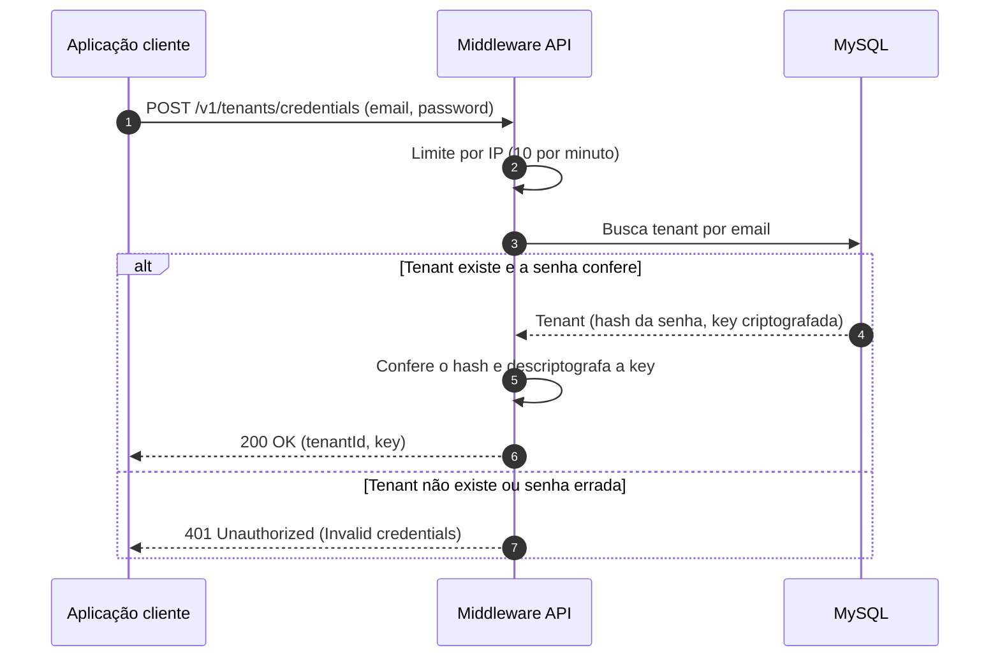
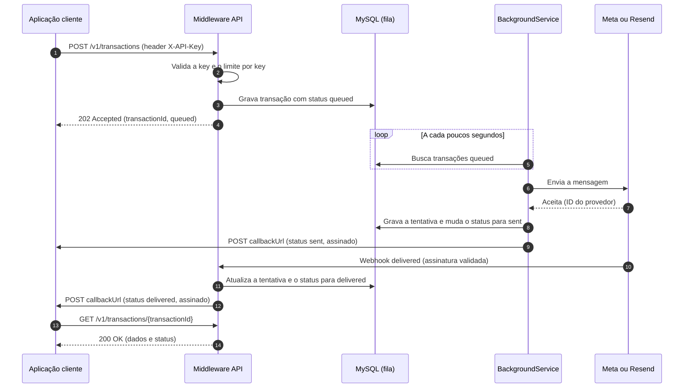
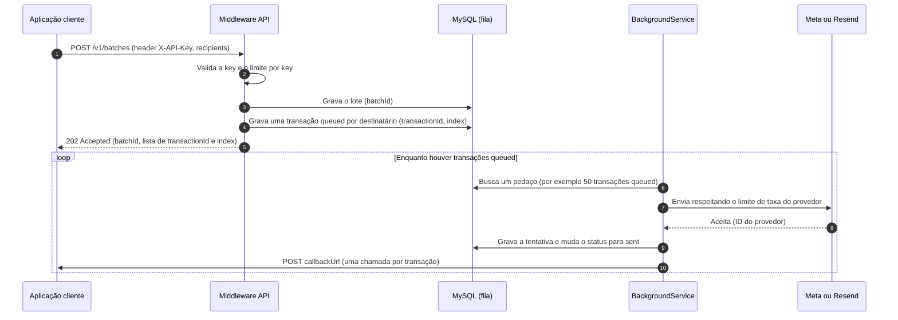
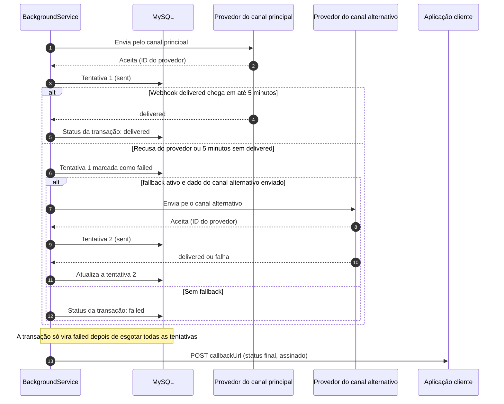
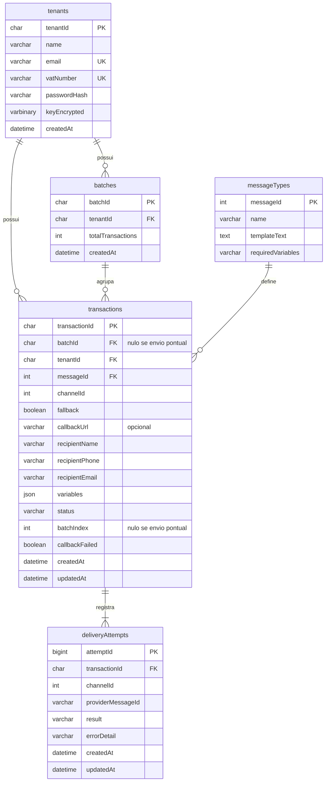

# Middleware: Documentação de Produto v2 (Trabalho de Conclusão de Curso)

## 1. Visão geral

### O que é

Middleware é uma plataforma backend de mensageria: um middleware que centraliza o envio de mensagens transacionais a usuários finais, sem interface própria voltada ao usuário final. Qualquer aplicação cliente aciona essa plataforma via chamada de API, ao invés de implementar e manter sua própria integração direta com os provedores de WhatsApp e e-mail.

### Propósito

Resolver, uma única vez e de forma reutilizável, um problema que se repete em qualquer sistema de negócio que precisa notificar seus usuários: como enviar uma mensagem, por qual canal, com qual template, e como saber depois se ela chegou.

### Canais suportados

1. WhatsApp, via Meta Cloud API.
2. E-mail transacional, via Resend.

### Características gerais

1. Multi-tenant desde a concepção: cada tenant se autentica enviando sua chave (key) no header `X-API-Key` de cada chamada. É essa chave que identifica o tenant e garante o isolamento de dados no registro de envios. Apenas os dois endpoints de cadastro (seção 6) não exigem a key, porque é neles que o tenant a obtém.
2. O catálogo de tipos de mensagem é fechado, limitado a um pequeno conjunto de mensagens pré-cadastradas pelo Middleware (cinco, ver seção 9). O tenant não cadastra mensagens próprias, apenas escolhe entre as existentes através do campo `messageId`.
3. O tenant pode consultar o catálogo de mensagens disponíveis, e o `messageId` de cada uma, através de uma API própria de consulta.
4. Cada chamada de envio carrega dois campos de identificação: `channelId`, que indica o canal da mensagem (1 para WhatsApp, 2 para e-mail, 3 para os dois), e `messageId`, que indica qual das mensagens do catálogo deve ser usada. Os dois campos são independentes: o mesmo `messageId` pode ser enviado por qualquer `channelId`.
5. O corpo (body) de cada chamada também carrega os dados customizados da mensagem: o destinatário e as variáveis que o template daquele `messageId` vai usar, como número do pedido e link.
6. Quando `channelId` é 1 ou 2 (um canal só), o tenant pode opcionalmente marcar `fallback: true`, pedindo que o Middleware tente o canal alternativo em caso de falha no canal principal, desde que o dado do canal alternativo também tenha sido enviado. Quando `channelId` é 3, o campo `fallback` é ignorado, porque os dois canais já são tentados de qualquer forma.
7. Para envios em lote, o corpo carrega uma lista de destinatários (`recipients`), cada um com seus próprios dados de contato e variáveis, sob o mesmo `channelId` e `messageId` do lote inteiro.
8. Para o canal WhatsApp, todos os tenants enviam usando um único número/linha corporativo do Middleware, não uma linha própria por tenant. Um único WhatsApp Business Account, com templates aprovados uma vez, serve para todos.
9. Para o canal e-mail vale a mesma lógica: todos os tenants enviam a partir de um único remetente do Middleware, configurado no próprio serviço, sem que o tenant informe remetente na chamada. Neste TCC é usado um remetente de teste. Em um produto comercial seria necessário um domínio corporativo próprio, verificado junto ao provedor de e-mail.
10. Serviço deliberadamente "burro" quanto ao destinatário e ao momento do envio: quem aciona o Middleware sempre resolve para quem enviar e decide quando enviar. O Middleware só sabe qual template usar e como preenchê-lo.
11. Todo envio, pontual ou em lote, passa pela mesma fila e pelo mesmo caminho de processamento (seção 5).

---

## 2. Diagramas

Cada diagrama conta uma interação só. Estão em Mermaid, que o GitHub renderiza diretamente no arquivo.

### 2.1 Cadastro do tenant

Mostra o `POST /v1/tenants`: normalização do VAT number, verificação de duplicidade, hash da senha e geração das credenciais.



### 2.2 Login e recuperação das credenciais

Mostra o `POST /v1/tenants/credentials`, com erro único para qualquer falha de autenticação.



### 2.3 Envio pontual

Mostra o `POST /v1/transactions`, o processamento pela fila, o webhook do provedor, o callback assinado e a consulta de status.



### 2.4 Envio em lote

Mostra o `POST /v1/batches`, a geração do `batchId` e de um `transactionId` por destinatário, e o processamento respeitando o limite do provedor.



### 2.5 Fallback e timeout

Mostra o que acontece quando o canal principal falha ou fica 5 minutos sem `delivered`.



### 2.6 Modelo do banco

Cinco tabelas. O catálogo de mensagens é carregado por seed.



---

## 3. Conceitos-chave

Antes de descrever os fluxos, três conceitos precisam estar claros, porque são referenciados o tempo todo no restante do documento.

1. Tenant: a aplicação cliente que está integrada ao Middleware, identificada pela key enviada no header de cada chamada. Cada tenant tem também um `tenantId`, identificador público usado para referência e suporte. Nenhuma API exige o `tenantId`: quem identifica o tenant nas chamadas é a key.
2. Transação: uma mensagem individual, seja ela enviada sozinha (envio isolado) ou como parte de um lote (envio em lote). Toda transação tem um `transactionId` próprio, gerado pelo Middleware no momento do processamento, nunca informado pelo tenant.
3. Lote: um agrupamento de transações enviadas juntas, de uma vez. Todo lote tem um `batchId` próprio, também gerado pelo Middleware.

A relação entre os dois: toda transação tem um `transactionId`. Quando a transação veio de um lote, ela também carrega o `batchId` ao qual pertence. Quando a transação veio de um envio isolado, o campo `batchId` fica nulo. Isso permite responder, para qualquer transação, se ela veio de uma chamada isolada ou de um lote, e qual lote.

Como o tenant não sabe o `transactionId` no momento do envio, já que ele só existe depois que o Middleware processa a chamada, a resposta do envio em lote devolve, para cada destinatário enviado, o `transactionId` gerado e o `index` dele na lista original, usado para o tenant relacionar a resposta com o destinatário que ele mandou.

Exemplo ilustrativo, resposta de um lote com dois destinatários:

```json
{
  "batchId": "b1e2c3d4-8f3a-4a2e-9c1d-7e6f5a4b3c2d",
  "transactions": [
    { "transactionId": "a1b2c3d4-...", "index": 0, "status": "queued" },
    { "transactionId": "f47ac10b-58cc-4372-a567-0e02b2c3d479", "index": 1, "status": "queued" }
  ]
}
```

Com isso, a consulta de status por `transactionId` sempre traz, junto com os dados da transação, o `batchId` correspondente quando ela pertence a um lote, ou `null` quando é um envio isolado.

### Tentativas de envio

A transação é o pedido: um por destinatário, com um único `transactionId`. Cada envio feito a um provedor é uma tentativa, registrada na tabela `deliveryAttempts` com canal, ID do provedor, resultado e data/hora. Uma transação tem de 1 a 2 tentativas:

1. Canal único sem fallback: 1 tentativa.
2. Canal único com fallback, quando o canal principal falhou: 2 tentativas.
3. `channelId` 3: 2 tentativas, uma por canal.

---

## 4. Princípios de arquitetura

1. Tenant resolvido pela key enviada no header de cada chamada, nunca fixo no código.
2. Toda tentativa de envio é registrada em banco (não em memória), com o ID do provedor (quando houver), o `transactionId`, o `batchId` (quando houver), o ID do tenant e o status do envio. Registrar também as falhas é essencial, por exemplo para identificar um usuário que nunca recebeu uma notificação por causa de um número de telefone cadastrado errado.
3. Abstração de tipo de mensagem: cada `messageId` do catálogo mapeia para um template aprovado, permitindo trocar o conteúdo do template no futuro sem impactar quem consome o serviço. O canal (`channelId`) é independente do template, escolhido pelo tenant a cada chamada.
4. Princípios gerais de arquitetura de software valem igualmente aqui: SQL parametrizado, injeção de dependência, separação de responsabilidades.
5. Segredos (chaves de criptografia, segredos de webhook, credenciais dos provedores) ficam em variáveis de ambiente, nunca no código.
6. Valores operacionais (intervalo do serviço de fila, tamanho do pedaço, tempo limite de transação, limites de requisição) ficam configuráveis por variável de ambiente.

---

## 5. Stack tecnológica e fila de envio

### Stack

1. .NET 10, C#.
2. MySQL como banco de dados.
3. Arquitetura em camadas (N-tier).
4. xUnit para testes unitários.
5. Docker para containerização.
6. Hospedagem no Railway.
7. Meta Cloud API para envio por WhatsApp.
8. Resend para envio por e-mail.

### Fila de envio

A fila é o próprio MySQL. Não existe broker dedicado. As transações gravadas com status `queued` são a fila, e um `BackgroundService` do .NET, sempre ativo dentro da aplicação, processa essas linhas.

1. O serviço roda em loop: busca no banco um pedaço das transações `queued` (por exemplo 50 por vez), processa, e se não achar nada espera um intervalo curto (por exemplo 5 segundos) antes de repetir.
2. Se o container reiniciar, o serviço sobe de novo e continua de onde parou, porque o estado está nas linhas do banco.
3. O envio pontual (`POST /v1/transactions`) usa o mesmo caminho do lote: a API grava `queued`, responde `202`, e o serviço faz o envio. Existe um único caminho de envio, e o envio pontual espera no máximo o intervalo do serviço.
4. O serviço respeita os limites de taxa dos provedores.

### Quem atualiza o status

1. `queued` para `sent`: o serviço em segundo plano, quando o provedor aceita a mensagem e devolve seu ID.
2. `sent` para `delivered`: o webhook do provedor, com assinatura validada.
3. `sent` para `failed` por tempo limite: o serviço em segundo plano, que em cada rodada procura transações em `sent` há mais de 5 minutos sem `delivered`.
4. `failed` imediato, quando o provedor recusa o envio: o serviço em segundo plano.

Toda mudança de status dispara o callback para o tenant.

### Status oficiais de uma transação

Os mesmos quatro status valem para os dois canais.

| Status | Significado |
|---|---|
| `queued` | Aceita pelo Middleware e aguardando envio. |
| `sent` | Entregue ao provedor, que aceitou a mensagem. |
| `delivered` | O provedor confirmou a entrega ao destino. Não garante caixa de entrada nem leitura. |
| `failed` | Falhou. Com fallback, só é marcado depois de esgotar todas as tentativas. |

### Tempo limite e fallback

Se a transação não receber `delivered` em 5 minutos, a tentativa é considerada falha e o fallback é acionado, se estiver ativo. O tempo é fixo para todos os canais e configurável por variável de ambiente. O status da transação é calculado a partir das tentativas e vira `failed` apenas quando todas falharam.

---

## 6. Cadastro e credenciais do tenant

### O que é

Dois endpoints públicos, os únicos que não exigem a key, porque é neles que o tenant a obtém. O cadastro é feito inteiramente por API: não há script de banco nem interface própria do Middleware.

### Cadastro: `POST /v1/tenants`

1. O tenant informa nome, e-mail (que é o login), senha e VAT number.
2. O Middleware normaliza o VAT number: remove espaços (`Trim`), converte para maiúsculas (`ToUpperInvariant`) e só então valida o formato.
3. Formato do VAT number neste TCC: `IE` seguido de 7 dígitos (exemplo: `IE1234567`). É uma simplificação: o VAT irlandês real termina com 1 ou 2 letras. Não se valida se o número existe, apenas o formato.
4. O Middleware verifica se já existe cadastro com o mesmo VAT number ou o mesmo e-mail. Se existir, responde `409 Conflict`.
5. Se não existir, grava a senha com hash, gera o `tenantId` e a key, grava a key criptografada e devolve as credenciais.

```json
POST /v1/tenants

{
  "name": "Empresa Exemplo",
  "email": "empresa@example.com",
  "password": "senhaDoTenant",
  "vatNumber": "ie1234567"
}
```

```json
201 Created

{
  "tenantId": "9d2f4c1e-7a3b-4c55-8e21-3b6a9f0c1d42",
  "key": "mw_live_xxxxxxxxxxxxxxxx"
}
```

```json
409 Conflict

{
  "error": "Tenant already registered"
}
```

### Login e recuperação das credenciais: `POST /v1/tenants/credentials`

1. O tenant informa e-mail e senha no body. Usa-se POST, e não GET, para a senha nunca aparecer na URL, que é registrada em logs de servidor, de proxy e da hospedagem.
2. Se confere, a resposta devolve o `tenantId` e a mesma key do cadastro.
3. Se não confere, a resposta é um erro único, sem distinguir "tenant não cadastrado" de "senha errada", para não revelar quais e-mails existem.

```json
POST /v1/tenants/credentials

{
  "email": "empresa@example.com",
  "password": "senhaDoTenant"
}
```

```json
200 OK

{
  "tenantId": "9d2f4c1e-7a3b-4c55-8e21-3b6a9f0c1d42",
  "key": "mw_live_xxxxxxxxxxxxxxxx"
}
```

```json
401 Unauthorized

{
  "error": "Invalid credentials"
}
```

### Regras de negócio importantes

1. A senha é guardada somente como hash (bcrypt ou Argon2).
2. A key é guardada de forma recuperável, para ser devolvida no login, mas criptografada (por exemplo AES), nunca em texto aberto. Ver o débito técnico na seção 11.
3. O `tenantId` é o identificador público do tenant, usado para referência e suporte. Nenhuma API o exige. Ele existe, entre outros motivos, para facilitar a explicação e a demonstração do sistema.
4. Os dois endpoints têm limite de requisições por IP (seção 10).

---

## 7. Envio pontual de mensagem (API assíncrona)

### O que é

Canal de envio para mensagens individuais e imediatas, onde quem aciona precisa de confirmação de que o envio foi aceito para processamento.

### Como funciona

1. Aplicação cliente (ex: um sistema de gestão de frotas ou de agendamentos) chama a API do Middleware, com a key no header `X-API-Key`, informando o `messageId` da mensagem catalogada, o `channelId`, opcionalmente `fallback`, o `callbackUrl`, o destinatário e as variáveis a preencher.
2. O Middleware valida a chamada e mapeia o `messageId` para o template aprovado correspondente.
3. O Middleware gera um `transactionId` e registra a transação no banco com status `queued` (tenant, destinatário, `messageId`, `channelId`, `transactionId`, `batchId` nulo, `callbackUrl`, data/hora).
4. O Middleware retorna `202 Accepted` com o `transactionId` e o status `queued` para quem chamou.
5. O `BackgroundService` pega a transação na fila, executa o envio via provedor (Meta Cloud API para WhatsApp, Resend para e-mail), conforme o `channelId` informado, e registra uma tentativa em `deliveryAttempts` com o ID devolvido pelo provedor.
6. Quando o status da transação mudar (ex: enviado, entregue, falhou), o Middleware notifica a aplicação cliente através de uma chamada de callback para a `callbackUrl` informada naquela transação.

### Regras de negócio importantes

1. Usado para mensagens que precisam ser entregues rapidamente e onde uma única pessoa é notificada por vez, como o convite de primeiro acesso e o reset de senha. O envio sai em no máximo o intervalo do serviço de fila (alguns segundos).
2. O Middleware não decide se deve enviar ou não, apenas executa e confirma. A decisão de acionar já foi tomada por quem chamou.
3. O `callbackUrl` é informado a cada chamada, não é um dado cadastrado previamente pelo tenant. Se vier ausente, o Middleware apenas não notifica, o tenant fica dependendo da consulta manual de status.
4. O callback tem uma única tentativa. Se a chamada falhar, o Middleware registra no banco que o callback falhou, e o tenant consulta o status manualmente. Retentativa com intervalo crescente fica como evolução futura.
5. Todo callback é assinado: o Middleware calcula o HMAC-SHA256 do body usando a key do tenant como segredo e envia o resultado no header `X-Middleware-Signature`. O tenant recalcula a assinatura e confere, para ter certeza de que o aviso veio do Middleware.
6. O webhook recebido da Meta e do Resend tem a assinatura validada antes de atualizar qualquer transação. O que não bater com o segredo é rejeitado.
7. O Middleware devolve `429 Too Many Requests` quando o tenant excede o limite de requisições (seção 10).

### Contrato técnico

**Envio da mensagem:**

```json
POST /v1/transactions
X-API-Key: {{key}}

{
  "channelId": 3,
  "messageId": 5,
  "fallback": true,
  "callbackUrl": "https://tenant.example.com/webhooks/middleware",
  "recipient": {
    "name": "Maria Silva",
    "phone": "+353123456789",
    "email": "maria@example.com",
    "variables": {
      "registrationNumber": "12345",
      "institutionName": "Instituto Exemplo",
      "link": "https://example.com/visa-renewal/12345"
    }
  }
}
```

```json
202 Accepted

{
  "transactionId": "f47ac10b-58cc-4372-a567-0e02b2c3d479",
  "status": "queued"
}
```

**Callback (notificação de mudança de status):**

```json
POST {callbackUrl}
X-Middleware-Signature: {{hmacSha256DoBody}}

{
  "transactionId": "f47ac10b-58cc-4372-a567-0e02b2c3d479",
  "batchId": null,
  "status": "delivered",
  "updatedAt": "2026-09-23T14:02:04Z"
}
```

**Consulta de status:**

```json
GET /v1/transactions/f47ac10b-58cc-4372-a567-0e02b2c3d479
X-API-Key: {{key}}

200 OK

{
  "transactionId": "f47ac10b-58cc-4372-a567-0e02b2c3d479",
  "batchId": null,
  "messageId": 5,
  "channelId": 3,
  "recipient": {
    "name": "Maria Silva",
    "phone": "+353123456789",
    "email": "maria@example.com"
  },
  "status": "delivered",
  "createdAt": "2026-09-23T14:02:00Z",
  "updatedAt": "2026-09-23T14:02:04Z"
}
```

### Padrão de integração

Chamada de API que aceita o pedido e responde de imediato (`202`), com o processamento assíncrono pela fila no banco, consumida por aplicações clientes em fluxos como autenticação e recuperação de acesso.

---

## 8. Envio em massa de mensagem (lote)

### O que é

Canal de envio para lembretes ou notificações disparadas para muitos destinatários de uma vez, sem necessidade de resposta imediata de cada transação individual.

### Como funciona

1. A aplicação cliente publica um lote, com a key no header `X-API-Key`, informando o `messageId`, o `channelId`, opcionalmente `fallback` e `callbackUrl`, válidos para o lote inteiro, e a lista `recipients` com os dados e as variáveis de cada destinatário.
2. O Middleware gera um `batchId` para o conjunto inteiro, e um `transactionId` para cada destinatário dentro dele, todos com status `queued`.
3. O Middleware responde `202 Accepted` com o `batchId` e, para cada destinatário, o `transactionId` e o `index`.
4. O `BackgroundService` processa a fila de forma assíncrona, respeitando os limites de taxa do provedor (seção 5).
5. Cada transação processada é registrada com seu `transactionId` e o `batchId` ao qual pertence, do mesmo jeito que no envio isolado, mas com o vínculo ao lote preenchido.
6. Quando o status de cada transação do lote mudar, o Middleware notifica a aplicação cliente através de uma chamada de callback para a `callbackUrl` informada, uma chamada por transação, com as mesmas regras de assinatura e de tentativa única do envio pontual.

### Regras de negócio importantes

Usado para casos como lembretes periódicos, onde a aplicação cliente varre diariamente uma condição de negócio (ex: pendências, prazos vencidos) e dispara uma notificação para cada usuário afetado de uma vez.

Exemplo: a aplicação cliente controla quem tem visto válido, vencido ou a vencer. A aplicação cliente gera uma lista de usuários com visto vencido e manda um lote de notificações informando que a pessoa precisa regularizar a situação, e que até lá o cadastro ficará suspenso.

O `callbackUrl` é informado a cada chamada de lote, não é um dado cadastrado previamente pelo tenant. Se vier ausente, o Middleware apenas não notifica, o tenant fica dependendo da consulta manual de status.

Não existe consulta agregada por `batchId`. O tenant consulta transação por transação ou usa os callbacks.

### Contrato técnico

**Envio do lote:**

```json
POST /v1/batches
X-API-Key: {{key}}

{
  "channelId": 1,
  "messageId": 5,
  "fallback": true,
  "callbackUrl": "https://tenant.example.com/webhooks/middleware",
  "recipients": [
    {
      "name": "Maria Silva",
      "phone": "+353123456789",
      "email": "maria@example.com",
      "variables": {
        "registrationNumber": "12345",
        "institutionName": "Instituto Exemplo",
        "link": "https://example.com/visa-renewal/12345"
      }
    },
    {
      "name": "Eva Silva",
      "phone": "+353123456780",
      "email": "eva@example.com",
      "variables": {
        "registrationNumber": "54321",
        "institutionName": "Instituto Exemplo",
        "link": "https://example.com/visa-renewal/54321"
      }
    }
  ]
}
```

```json
202 Accepted

{
  "batchId": "b1e2c3d4-8f3a-4a2e-9c1d-7e6f5a4b3c2d",
  "transactions": [
    { "transactionId": "a1b2c3d4-...", "index": 0, "status": "queued" },
    { "transactionId": "f47ac10b-58cc-4372-a567-0e02b2c3d479", "index": 1, "status": "queued" }
  ]
}
```

**Callback (notificação de mudança de status, uma por transação):**

```json
POST {callbackUrl}
X-Middleware-Signature: {{hmacSha256DoBody}}

{
  "transactionId": "f47ac10b-58cc-4372-a567-0e02b2c3d479",
  "batchId": "b1e2c3d4-8f3a-4a2e-9c1d-7e6f5a4b3c2d",
  "status": "delivered",
  "updatedAt": "2026-09-23T14:02:04Z"
}
```

**Consulta de status de uma transação do lote:** segue o mesmo contrato da seção 7, `GET /v1/transactions/{transactionId}` com o header `X-API-Key`, com o `batchId` preenchido em vez de nulo.

### Padrão de integração

Fila de mensagens (mensageria assíncrona), com a aplicação cliente como produtora e o Middleware como consumidor. A fila é a própria tabela de transações no MySQL.

---

## 9. Tipos de mensagem (contrato)

### O que é

Cada tipo de mensagem suportado pelo Middleware tem um `messageId` próprio no catálogo, mapeando para um template de conteúdo aprovado. O canal de envio (`channelId`) é escolhido pelo tenant a cada chamada, independente do `messageId`: o mesmo template pode ser enviado por WhatsApp, e-mail, ou os dois.

Cada `messageId` tem um texto único, usado para WhatsApp e e-mail, no formato mais limitado dos dois. Não há versão de template por canal. Como o e-mail precisa de assunto, o assunto é o próprio nome do tipo de mensagem (por exemplo "Password Reset"). O catálogo fica na tabela `messageTypes`, carregada por seed.

### Catálogo de mensagens (fechado, cinco tipos)

| messageId | Nome | Descrição | Variáveis exigidas |
|---|---|---|---|
| 1 | First Access Invite | Enviado quando um novo usuário é cadastrado pela aplicação cliente, contendo o link para definição de senha. | `name`, `link` |
| 2 | Password Reset | Enviado quando um usuário solicita redefinir a senha, contendo o link com token. | `name`, `link` |
| 3 | Pending Reminder | Enviado aos usuários que ainda não completaram uma ação esperada dentro do prazo. | `name`, `link` |
| 4 | Order Shipped | Enviado quando um pedido do usuário sai para entrega. | `name`, `orderNumber`, `link` |
| 5 | Visa Expiration Notice | Enviado a usuários com visto de residência próximo do vencimento. | `name`, `registrationNumber`, `institutionName`, `link` |

Todos os cinco se enquadram na categoria Utility (utilidade) do WhatsApp Business, categoria de aprovação mais simples por não ter caráter promocional, mantendo um tom direto e informativo.

### Templates aprovados (mensagens ilustrativas)

**messageId 1, First Access Invite:**
```
Hi {{name}}, your access to the system has been created. To set your
password and get started, please use the link below: {{link}}
```

**messageId 2, Password Reset:**
```
Hi {{name}}, we received a request to reset your password. To
continue, use the link below: {{link}}. If you didn't request this,
you can safely ignore this message.
```

**messageId 3, Pending Reminder:**
```
Hi {{name}}, we haven't received your update yet for today. Please
take a moment to complete your pending record so everything stays
up to date. You can access the system here: {{link}}
```

**messageId 4, Order Shipped:**
```
Hi {{name}}, your order {{orderNumber}} has been shipped. For more
details, you can track it here: {{link}}
```

**messageId 5, Visa Expiration Notice:**
```
Hi {{name}}, we noticed that your residence visa is about to expire.
Your registration number {{registrationNumber}} is linked to this
document. If you have already started your renewal process, please
access the link below and complete the requested steps: {{link}}.
Regards, {{institutionName}}
```

### Contrato técnico

**Consulta do catálogo de mensagens:**

```json
GET /v1/message-types
X-API-Key: {{key}}

200 OK

[
  { "messageId": 1, "name": "First Access Invite" },
  { "messageId": 2, "name": "Password Reset" },
  { "messageId": 3, "name": "Pending Reminder" },
  { "messageId": 4, "name": "Order Shipped" },
  { "messageId": 5, "name": "Visa Expiration Notice" }
]
```

### Regras de negócio importantes

1. O catálogo é fechado, limitado a essas cinco mensagens. Novos tipos exigiriam alteração de escopo do Middleware, não é algo que o tenant cadastra por conta própria.
2. Em todos os tipos de mensagem, é sempre quem aciona o Middleware que resolve o destinatário (número de telefone ou endereço de e-mail) antes da chamada. O Middleware nunca decide ou descobre por conta própria para quem enviar.
3. O campo `name` do destinatário preenche automaticamente a variável `{{name}}` do template, sem precisar ser repetido dentro de `variables`. As demais variáveis exigidas pelo template (ver tabela do catálogo) vêm do objeto `variables` enviado na chamada.
4. Em todos os tipos de mensagem, o link vem inteiramente como variável fornecida pelo tenant na chamada. O Middleware apenas insere o valor no template, sem gerar ou validar o conteúdo do link. No caso do convite de primeiro acesso e do reset de senha, a geração e a validação do token de uso único também são responsabilidade do tenant.

---

## 10. Proteção contra abuso

1. Endpoints autenticados: limite de requisições por key, de 60 por minuto, configurável por variável de ambiente. Acima disso o Middleware responde `429 Too Many Requests`. O limite conta requisições, não destinatários: um lote com 300 destinatários conta como 1 chamada.
2. Endpoints públicos (`POST /v1/tenants` e `POST /v1/tenants/credentials`): limite por IP, de 10 requisições por janela de 1 minuto, configurável por variável de ambiente. Como esses endpoints não têm key, o limite por key não se aplica a eles.
3. Ao exceder o limite, a resposta é `429` com o header `Retry-After` indicando quantos segundos esperar. A janela é fixa: o contador zera ao fim do minuto, e o IP ou a key volta a ser atendido sem nenhum castigo adicional.
4. O limite protege contra parceiro mal implementado e abuso de um tenant, como consultar o mesmo status em loop em vez de aguardar o callback. Não protege contra ataque de negação de serviço (DDoS) em massa, porque a requisição já chegou ao servidor e já consumiu recursos.
5. A proteção contra DDoS real é responsabilidade da infraestrutura: configurar um limite de gasto no Railway (para que o pior caso seja o serviço pausar, e não uma fatura alta) e colocar o Cloudflare na frente da aplicação.
6. Bloqueio crescente após falhas seguidas (por exemplo 15 minutos depois de várias tentativas de senha erradas) fica como evolução futura.

---

## 11. Lista de APIs expostas

Consolidação de todos os endpoints definidos nas seções anteriores. Todas as chamadas autenticadas exigem o header `X-API-Key`, conforme descrito na seção 1. Os dois endpoints de cadastro não exigem key.

| Método | Endpoint | Autenticação | Descrição | Detalhado na seção |
|---|---|---|---|---|
| POST | `/v1/tenants` | Pública | Cadastro de um novo tenant | 6 |
| POST | `/v1/tenants/credentials` | Pública | Login com e-mail e senha, devolve `tenantId` e key | 6 |
| POST | `/v1/transactions` | `X-API-Key` | Envio pontual de uma mensagem | 7 |
| GET | `/v1/transactions/{transactionId}` | `X-API-Key` | Consulta de status de uma transação (isolada ou de lote) | 7 |
| POST | `/v1/batches` | `X-API-Key` | Envio de um lote de mensagens | 8 |
| GET | `/v1/message-types` | `X-API-Key` | Consulta do catálogo de mensagens disponíveis | 9 |

Além disso, o Middleware expõe endpoints de entrada para os provedores (webhooks da Meta e do Resend), protegidos por validação de assinatura e não destinados aos tenants.

O Middleware também faz uma chamada de saída, não exposta como API própria: o callback (`POST {callbackUrl}`), disparado para a URL informada pelo tenant a cada transação, sempre que o status dela muda, com assinatura no header `X-Middleware-Signature`.

---

## 12. Escopo de demonstração e estrutura do repositório

### Escopo de demonstração

O escopo do TCC é a API. O repositório de código também contém uma aplicação cliente (frontend) que simula uma aplicação real consumindo o Middleware durante a apresentação. Esse frontend não faz parte do produto: ele conversa com o Middleware somente pelas APIs documentadas, sem acessar o banco nem importar código dele. Para validação durante o desenvolvimento usa-se o Postman.

### Estrutura de pastas do repositório de código

A especificação e os diagramas ficam em um repositório próprio (`middlewareMessage`). O repositório de código não tem pasta `docs/`.

```
middleware-project/
  README.md
  .gitignore
  CODEOWNERS
  docker-compose.yml
  src/
    middleware/
      Middleware.Api/            (controllers, endpoints, configuração)
      Middleware.Application/    (regras de negócio, BackgroundService)
      Middleware.Data/           (acesso ao MySQL, repositórios, seed)
      Middleware.Tests/          (xUnit)
      Middleware.sln
    frontend/                    (aplicação cliente de demonstração)
```

Cada pessoa trabalha em sua pasta de topo, em branches próprios, com pull request revisado pela outra. O `CODEOWNERS` define quem responde por cada pasta, e o histórico do GitHub mostra a autoria de cada um.

---

## 13. Débitos técnicos conhecidos e evoluções futuras

1. Key armazenada de forma recuperável: o padrão de mercado é guardar somente o hash da key e, se ela for perdida, gerar uma nova (rotação). Neste TCC a key é criptografada e devolvida no login, por simplicidade.
2. Fila no MySQL: um broker dedicado (por exemplo RabbitMQ) é a evolução natural caso o volume cresça.
3. Retentativa do callback: hoje há uma única tentativa. Evolução: tentativas com intervalo crescente, e depois uma tabela de retentativas com worker.
4. Bloqueio crescente nos endpoints públicos após falhas seguidas de autenticação.
5. VAT number simplificado para `IE` mais 7 dígitos, sem validar a existência. O formato real tem 1 ou 2 letras no final.
6. Tempo limite único para todos os canais. Evolução: tempo por canal.
7. Template único por `messageId`. Evolução: uma versão por canal, com HTML no e-mail.
8. Recibo de leitura (`read`) não suportado, porque não existe de forma confiável no e-mail.
9. Consulta agregada de lote por `batchId` não existe. Evolução possível: `GET /v1/batches/{batchId}` com o resumo por status.
10. Remetente de e-mail de teste. Um produto comercial exige domínio corporativo verificado junto ao provedor.

---

## 14. Pendências

1. Revisar o modelo do banco (diagrama 2.6): tipos de campo, índices e chaves, antes de iniciar a implementação.
2. Definir o formato final da key (prefixo, tamanho e alfabeto).
3. Definir os valores padrão das variáveis de ambiente (intervalo do serviço, tamanho do pedaço, tempo limite, limites de requisição).
