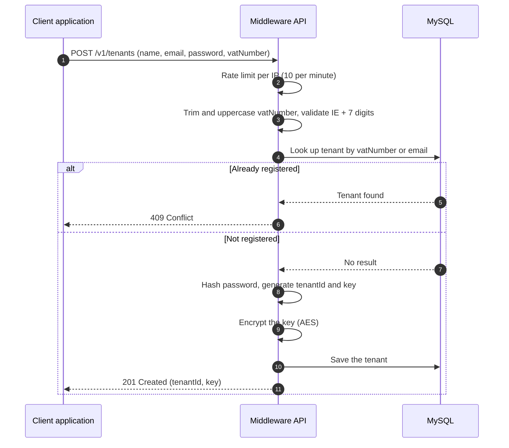
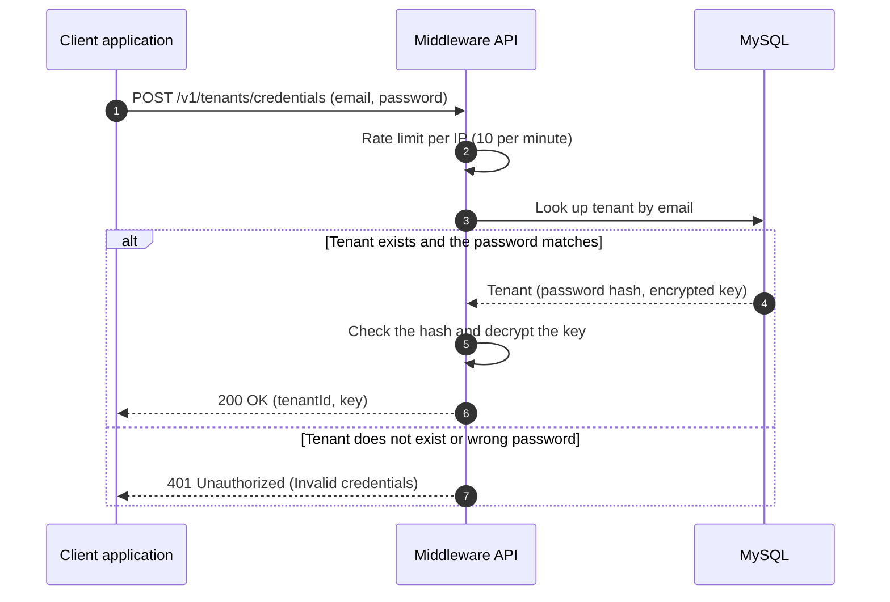
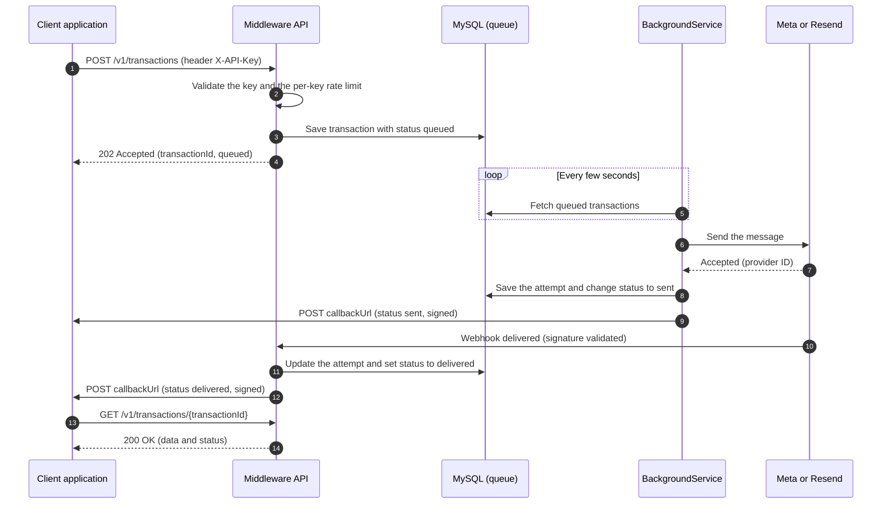
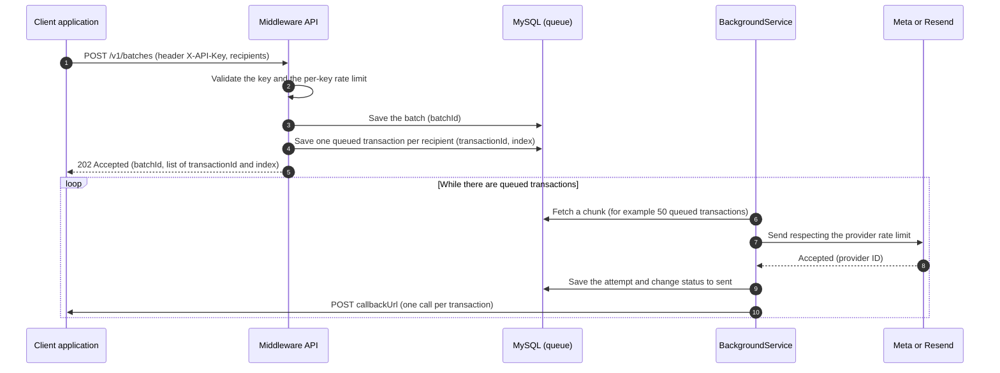
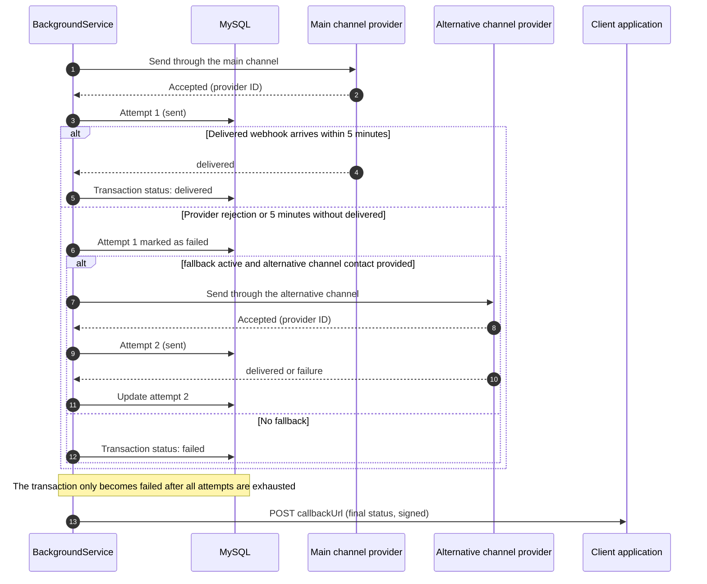
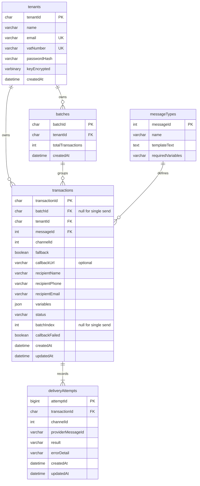

# Middleware: Product Documentation v2 (Final Course Project)

## 1. Overview

### What it is

Middleware is a backend messaging platform: a middleware that centralizes the sending of transactional messages to end users, with no user-facing interface of its own. Any client application triggers this platform through an API call, instead of implementing and maintaining its own direct integration with the WhatsApp and e-mail providers.

### Purpose

To solve, once and in a reusable way, a problem that repeats in any business system that needs to notify its users: how to send a message, through which channel, with which template, and how to find out afterwards whether it arrived.

### Supported channels

1. WhatsApp, via Meta Cloud API.
2. Transactional e-mail, via Resend.

### General characteristics

1. Multi-tenant by design: each tenant authenticates by sending its key in the `X-API-Key` header of every call. This key identifies the tenant and guarantees data isolation in the sending records. Only the two registration endpoints (section 6) do not require the key, because that is where the tenant obtains it.
2. The message type catalog is closed, limited to a small set of messages pre-registered by Middleware (five, see section 9). The tenant does not register its own messages, it only chooses among the existing ones through the `messageId` field.
3. The tenant can query the catalog of available messages, and the `messageId` of each one, through a dedicated query API.
4. Each send call carries two identification fields: `channelId`, which indicates the message channel (1 for WhatsApp, 2 for e-mail, 3 for both), and `messageId`, which indicates which message from the catalog must be used. The two fields are independent: the same `messageId` can be sent through any `channelId`.
5. The body of each call also carries the custom data of the message: the recipient and the variables that the template of that `messageId` will use, such as order number and link.
6. When `channelId` is 1 or 2 (a single channel), the tenant can optionally set `fallback: true`, asking Middleware to try the alternative channel if the main channel fails, as long as the contact data for the alternative channel was also sent. When `channelId` is 3, the `fallback` field is ignored, because both channels are attempted anyway.
7. For batch sends, the body carries a list of recipients (`recipients`), each with its own contact data and variables, under the same `channelId` and `messageId` for the whole batch.
8. For the WhatsApp channel, all tenants send using a single corporate number/line owned by Middleware, not one line per tenant. A single WhatsApp Business Account, with templates approved once, serves everyone.
9. The same logic applies to the e-mail channel: all tenants send from a single Middleware sender, configured in the service itself, without the tenant providing a sender in the call. In this project a test sender is used. In a commercial product, a corporate domain of its own, verified with the e-mail provider, would be required.
10. A deliberately "dumb" service regarding the recipient and the time of sending: whoever triggers Middleware always decides who to send to and when to send. Middleware only knows which template to use and how to fill it in.
11. Every send, single or batch, goes through the same queue and the same processing path (section 5).

---

## 2. Diagrams

Each diagram tells the story of a single interaction. They are written in Mermaid, which GitHub renders directly in the file.

### 2.1 Tenant registration

Shows `POST /v1/tenants`: VAT number normalization, duplicate check, password hashing and credential generation.



### 2.2 Login and credential recovery

Shows `POST /v1/tenants/credentials`, with a single error for any authentication failure.



### 2.3 Single send

Shows `POST /v1/transactions`, processing through the queue, the provider webhook, the signed callback and the status query.



### 2.4 Batch send

Shows `POST /v1/batches`, the generation of the `batchId` and of one `transactionId` per recipient, and the processing that respects the provider rate limit.



### 2.5 Fallback and timeout

Shows what happens when the main channel fails or stays 5 minutes without `delivered`.



### 2.6 Database model

Five tables. The message catalog is loaded by seed.



---

## 3. Key concepts

Before describing the flows, three concepts need to be clear, because they are referenced throughout the rest of the document.

1. Tenant: the client application integrated with Middleware, identified by the key sent in the header of every call. Each tenant also has a `tenantId`, a public identifier used for reference and support. No API requires the `tenantId`: what identifies the tenant in calls is the key.
2. Transaction: an individual message, whether sent alone (single send) or as part of a batch (batch send). Every transaction has its own `transactionId`, generated by Middleware at processing time, never provided by the tenant.
3. Batch: a group of transactions sent together, at once. Every batch has its own `batchId`, also generated by Middleware.

The relationship between the two: every transaction has a `transactionId`. When the transaction came from a batch, it also carries the `batchId` it belongs to. When the transaction came from a single send, the `batchId` field is null. This makes it possible to answer, for any transaction, whether it came from a single call or from a batch, and which batch.

Since the tenant does not know the `transactionId` at the time of sending, because it only exists after Middleware processes the call, the response to a batch send returns, for each recipient sent, the generated `transactionId` and its `index` in the original list, which the tenant uses to match the response to the recipient it sent.

Illustrative example, response of a batch with two recipients:

```json
{
  "batchId": "b1e2c3d4-8f3a-4a2e-9c1d-7e6f5a4b3c2d",
  "transactions": [
    { "transactionId": "a1b2c3d4-...", "index": 0, "status": "queued" },
    { "transactionId": "f47ac10b-58cc-4372-a567-0e02b2c3d479", "index": 1, "status": "queued" }
  ]
}
```

With this, the status query by `transactionId` always returns, together with the transaction data, the corresponding `batchId` when it belongs to a batch, or `null` when it is a single send.

### Delivery attempts

The transaction is the order: one per recipient, with a single `transactionId`. Each send made to a provider is an attempt, recorded in the `deliveryAttempts` table with channel, provider ID, result and date/time. A transaction has 1 to 2 attempts:

1. Single channel without fallback: 1 attempt.
2. Single channel with fallback, when the main channel failed: 2 attempts.
3. `channelId` 3: 2 attempts, one per channel.

---

## 4. Architecture principles

1. Tenant resolved by the key sent in the header of every call, never fixed in the code.
2. Every send attempt is recorded in the database (not in memory), with the provider ID (when there is one), the `transactionId`, the `batchId` (when there is one), the tenant ID and the send status. Recording failures as well is essential, for example to identify a user who never received a notification because of a wrongly registered phone number.
3. Message type abstraction: each `messageId` in the catalog maps to an approved template, allowing the template content to be changed in the future without affecting whoever consumes the service. The channel (`channelId`) is independent of the template, chosen by the tenant on each call.
4. General software architecture principles apply here equally: parameterized SQL, dependency injection, separation of concerns.
5. Secrets (encryption keys, webhook secrets, provider credentials) live in environment variables, never in the code.
6. Operational values (queue service interval, chunk size, transaction timeout, request limits) are configurable through environment variables.

---

## 5. Technology stack and sending queue

### Stack

1. .NET 10, C#.
2. MySQL as the database.
3. Layered architecture (N-tier).
4. xUnit for unit tests.
5. Docker for containerization.
6. Hosting on Railway.
7. Meta Cloud API for sending through WhatsApp.
8. Resend for sending through e-mail.

### Sending queue

The queue is MySQL itself. There is no dedicated broker. The transactions saved with status `queued` are the queue, and a .NET `BackgroundService`, always active inside the application, processes those rows.

1. The service runs in a loop: it fetches a chunk of `queued` transactions from the database (for example 50 at a time), processes them, and if it finds nothing it waits a short interval (for example 5 seconds) before repeating.
2. If the container restarts, the service starts again and continues from where it stopped, because the state lives in the database rows.
3. The single send (`POST /v1/transactions`) uses the same path as the batch: the API saves `queued`, responds `202`, and the service performs the send. There is a single sending path, and the single send waits at most the service interval.
4. The service respects the rate limits of the providers.

### Who updates the status

1. `queued` to `sent`: the background service, when the provider accepts the message and returns its ID.
2. `sent` to `delivered`: the provider webhook, with the signature validated.
3. `sent` to `failed` by timeout: the background service, which on each round looks for transactions in `sent` for more than 5 minutes without `delivered`.
4. Immediate `failed`, when the provider rejects the send: the background service.

Every status change triggers the callback to the tenant.

### Official transaction statuses

The same four statuses apply to both channels.

| Status | Meaning |
|---|---|
| `queued` | Accepted by Middleware and waiting to be sent. |
| `sent` | Handed to the provider, which accepted the message. |
| `delivered` | The provider confirmed delivery to the destination. It does not guarantee inbox placement or that it was read. |
| `failed` | Failed. With fallback, it is only set after all attempts are exhausted. |

### Timeout and fallback

If the transaction does not receive `delivered` within 5 minutes, the attempt is considered failed and the fallback is triggered, if it is active. The time is fixed for all channels and configurable through an environment variable. The transaction status is calculated from the attempts and becomes `failed` only when all of them have failed.

---

## 6. Tenant registration and credentials

### What it is

Two public endpoints, the only ones that do not require the key, because that is where the tenant obtains it. Registration is done entirely through the API: there is no database script and no interface of Middleware's own.

### Registration: `POST /v1/tenants`

1. The tenant provides name, e-mail (which is the login), password and VAT number.
2. Middleware normalizes the VAT number: it removes spaces (`Trim`), converts to uppercase (`ToUpperInvariant`) and only then validates the format.
3. VAT number format in this project: `IE` followed by 7 digits (example: `IE1234567`). This is a simplification: the real Irish VAT number ends with 1 or 2 letters. Whether the number exists is not validated, only the format.
4. Middleware checks whether a registration with the same VAT number or the same e-mail already exists. If so, it responds `409 Conflict`.
5. If not, it stores the password as a hash, generates the `tenantId` and the key, stores the key encrypted and returns the credentials.

```json
POST /v1/tenants

{
  "name": "Example Company",
  "email": "company@example.com",
  "password": "tenantPassword",
  "vatNumber": "ie1234567"
}
```

```json
201 Created

{
  "tenantId": "9d2f4c1e-7a3b-4c55-8e21-3b6a9f0c1d42",
  "key": "mw_live_xxxxxxxxxxxxxxxx"
}
```

```json
409 Conflict

{
  "error": "Tenant already registered"
}
```

### Login and credential recovery: `POST /v1/tenants/credentials`

1. The tenant provides e-mail and password in the body. POST is used, not GET, so the password never appears in the URL, which is recorded in server, proxy and hosting logs.
2. If they match, the response returns the `tenantId` and the same key issued at registration.
3. If they do not match, the response is a single error, without distinguishing "tenant not registered" from "wrong password", so that it does not reveal which e-mails exist.

```json
POST /v1/tenants/credentials

{
  "email": "company@example.com",
  "password": "tenantPassword"
}
```

```json
200 OK

{
  "tenantId": "9d2f4c1e-7a3b-4c55-8e21-3b6a9f0c1d42",
  "key": "mw_live_xxxxxxxxxxxxxxxx"
}
```

```json
401 Unauthorized

{
  "error": "Invalid credentials"
}
```

### Important business rules

1. The password is stored only as a hash (bcrypt or Argon2).
2. The key is stored in a recoverable way, so it can be returned at login, but encrypted (for example AES), never in plain text. See the technical debt in section 13.
3. The `tenantId` is the public identifier of the tenant, used for reference and support. No API requires it. It exists, among other reasons, to make the system easier to explain and demonstrate.
4. Both endpoints have a per-IP request limit (section 10).

---

## 7. Single message sending (asynchronous API)

### What it is

Sending channel for individual, immediate messages, where the caller needs confirmation that the send was accepted for processing.

### How it works

1. A client application (e.g. a fleet management or scheduling system) calls the Middleware API, with the key in the `X-API-Key` header, providing the `messageId` of the cataloged message, the `channelId`, optionally `fallback`, the `callbackUrl`, the recipient and the variables to fill in.
2. Middleware validates the call and maps the `messageId` to the corresponding approved template.
3. Middleware generates a `transactionId` and records the transaction in the database with status `queued` (tenant, recipient, `messageId`, `channelId`, `transactionId`, null `batchId`, `callbackUrl`, date/time).
4. Middleware returns `202 Accepted` with the `transactionId` and the status `queued` to the caller.
5. The `BackgroundService` picks up the transaction from the queue, performs the send through the provider (Meta Cloud API for WhatsApp, Resend for e-mail), according to the `channelId` provided, and records an attempt in `deliveryAttempts` with the ID returned by the provider.
6. When the transaction status changes (e.g. sent, delivered, failed), Middleware notifies the client application through a callback call to the `callbackUrl` provided for that transaction.

### Important business rules

1. Used for messages that need to be delivered quickly and where a single person is notified at a time, such as the first access invite and the password reset. The send goes out in at most the queue service interval (a few seconds).
2. Middleware does not decide whether to send or not, it only executes and confirms. The decision to trigger was already made by the caller.
3. The `callbackUrl` is provided on each call, it is not data previously registered by the tenant. If it is absent, Middleware simply does not notify, and the tenant depends on manual status queries.
4. The callback has a single attempt. If the call fails, Middleware records in the database that the callback failed, and the tenant queries the status manually. Retry with increasing intervals is left as a future evolution.
5. Every callback is signed: Middleware computes the HMAC-SHA256 of the body using the tenant key as the secret and sends the result in the `X-Middleware-Signature` header. The tenant recomputes the signature and checks it, to make sure the notice really came from Middleware.
6. The webhook received from Meta and Resend has its signature validated before any transaction is updated. Anything that does not match the secret is rejected.
7. Middleware returns `429 Too Many Requests` when the tenant exceeds the request limit (section 10).

### Technical contract

**Sending the message:**

```json
POST /v1/transactions
X-API-Key: {{key}}

{
  "channelId": 3,
  "messageId": 5,
  "fallback": true,
  "callbackUrl": "https://tenant.example.com/webhooks/middleware",
  "recipient": {
    "name": "Maria Silva",
    "phone": "+353123456789",
    "email": "maria@example.com",
    "variables": {
      "registrationNumber": "12345",
      "institutionName": "Example Institute",
      "link": "https://example.com/visa-renewal/12345"
    }
  }
}
```

```json
202 Accepted

{
  "transactionId": "f47ac10b-58cc-4372-a567-0e02b2c3d479",
  "status": "queued"
}
```

**Callback (status change notification):**

```json
POST {callbackUrl}
X-Middleware-Signature: {{hmacSha256OfBody}}

{
  "transactionId": "f47ac10b-58cc-4372-a567-0e02b2c3d479",
  "batchId": null,
  "status": "delivered",
  "updatedAt": "2026-09-23T14:02:04Z"
}
```

**Status query:**

```json
GET /v1/transactions/f47ac10b-58cc-4372-a567-0e02b2c3d479
X-API-Key: {{key}}

200 OK

{
  "transactionId": "f47ac10b-58cc-4372-a567-0e02b2c3d479",
  "batchId": null,
  "messageId": 5,
  "channelId": 3,
  "recipient": {
    "name": "Maria Silva",
    "phone": "+353123456789",
    "email": "maria@example.com"
  },
  "status": "delivered",
  "createdAt": "2026-09-23T14:02:00Z",
  "updatedAt": "2026-09-23T14:02:04Z"
}
```

### Integration pattern

API call that accepts the request and responds immediately (`202`), with asynchronous processing through the queue in the database, consumed by client applications in flows such as authentication and access recovery.

---

## 8. Bulk message sending (batch)

### What it is

Sending channel for reminders or notifications fired to many recipients at once, with no need for an immediate response for each individual transaction.

### How it works

1. The client application publishes a batch, with the key in the `X-API-Key` header, providing the `messageId`, the `channelId`, optionally `fallback` and `callbackUrl`, valid for the whole batch, and the `recipients` list with the data and variables of each recipient.
2. Middleware generates a `batchId` for the whole set, and a `transactionId` for each recipient within it, all with status `queued`.
3. Middleware responds `202 Accepted` with the `batchId` and, for each recipient, the `transactionId` and the `index`.
4. The `BackgroundService` processes the queue asynchronously, respecting the provider rate limits (section 5).
5. Each processed transaction is recorded with its `transactionId` and the `batchId` it belongs to, in the same way as in the single send, but with the batch link filled in.
6. When the status of each transaction in the batch changes, Middleware notifies the client application through a callback call to the `callbackUrl` provided, one call per transaction, with the same signature and single-attempt rules as the single send.

### Important business rules

Used for cases such as periodic reminders, where the client application scans a business condition daily (e.g. pending items, expired deadlines) and fires a notification to every affected user at once.

Example: the client application tracks who has a valid, expired or soon-to-expire visa. The client application generates a list of users with an expired visa and sends a batch of notifications saying the person needs to regularize their situation, and that until then their registration will be suspended.

The `callbackUrl` is provided on each batch call, it is not data previously registered by the tenant. If it is absent, Middleware simply does not notify, and the tenant depends on manual status queries.

There is no aggregated query by `batchId`. The tenant queries transaction by transaction or uses the callbacks.

### Technical contract

**Sending the batch:**

```json
POST /v1/batches
X-API-Key: {{key}}

{
  "channelId": 1,
  "messageId": 5,
  "fallback": true,
  "callbackUrl": "https://tenant.example.com/webhooks/middleware",
  "recipients": [
    {
      "name": "Maria Silva",
      "phone": "+353123456789",
      "email": "maria@example.com",
      "variables": {
        "registrationNumber": "12345",
        "institutionName": "Example Institute",
        "link": "https://example.com/visa-renewal/12345"
      }
    },
    {
      "name": "Eva Silva",
      "phone": "+353123456780",
      "email": "eva@example.com",
      "variables": {
        "registrationNumber": "54321",
        "institutionName": "Example Institute",
        "link": "https://example.com/visa-renewal/54321"
      }
    }
  ]
}
```

```json
202 Accepted

{
  "batchId": "b1e2c3d4-8f3a-4a2e-9c1d-7e6f5a4b3c2d",
  "transactions": [
    { "transactionId": "a1b2c3d4-...", "index": 0, "status": "queued" },
    { "transactionId": "f47ac10b-58cc-4372-a567-0e02b2c3d479", "index": 1, "status": "queued" }
  ]
}
```

**Callback (status change notification, one per transaction):**

```json
POST {callbackUrl}
X-Middleware-Signature: {{hmacSha256OfBody}}

{
  "transactionId": "f47ac10b-58cc-4372-a567-0e02b2c3d479",
  "batchId": "b1e2c3d4-8f3a-4a2e-9c1d-7e6f5a4b3c2d",
  "status": "delivered",
  "updatedAt": "2026-09-23T14:02:04Z"
}
```

**Status query for a batch transaction:** follows the same contract as section 7, `GET /v1/transactions/{transactionId}` with the `X-API-Key` header, with the `batchId` filled in instead of null.

### Integration pattern

Message queue (asynchronous messaging), with the client application as producer and Middleware as consumer. The queue is the transactions table itself in MySQL.

---

## 9. Message types (contract)

### What it is

Each message type supported by Middleware has its own `messageId` in the catalog, mapping to an approved content template. The sending channel (`channelId`) is chosen by the tenant on each call, independent of the `messageId`: the same template can be sent through WhatsApp, e-mail, or both.

Each `messageId` has a single text, used for both WhatsApp and e-mail, in the more limited format of the two. There is no per-channel template version. Since e-mail needs a subject, the subject is the name of the message type itself (for example "Password Reset"). The catalog lives in the `messageTypes` table, loaded by seed.

### Message catalog (closed, five types)

| messageId | Name | Description | Required variables |
|---|---|---|---|
| 1 | First Access Invite | Sent when a new user is registered by the client application, containing the link to set a password. | `name`, `link` |
| 2 | Password Reset | Sent when a user requests a password reset, containing the link with a token. | `name`, `link` |
| 3 | Pending Reminder | Sent to users who have not yet completed an expected action within the deadline. | `name`, `link` |
| 4 | Order Shipped | Sent when a user's order goes out for delivery. | `name`, `orderNumber`, `link` |
| 5 | Visa Expiration Notice | Sent to users whose residence visa is close to expiring. | `name`, `registrationNumber`, `institutionName`, `link` |

All five fall into the Utility category of WhatsApp Business, the simplest approval category because it has no promotional nature, keeping a direct and informative tone.

### Approved templates (illustrative messages)

**messageId 1, First Access Invite:**
```
Hi {{name}}, your access to the system has been created. To set your
password and get started, please use the link below: {{link}}
```

**messageId 2, Password Reset:**
```
Hi {{name}}, we received a request to reset your password. To
continue, use the link below: {{link}}. If you didn't request this,
you can safely ignore this message.
```

**messageId 3, Pending Reminder:**
```
Hi {{name}}, we haven't received your update yet for today. Please
take a moment to complete your pending record so everything stays
up to date. You can access the system here: {{link}}
```

**messageId 4, Order Shipped:**
```
Hi {{name}}, your order {{orderNumber}} has been shipped. For more
details, you can track it here: {{link}}
```

**messageId 5, Visa Expiration Notice:**
```
Hi {{name}}, we noticed that your residence visa is about to expire.
Your registration number {{registrationNumber}} is linked to this
document. If you have already started your renewal process, please
access the link below and complete the requested steps: {{link}}.
Regards, {{institutionName}}
```

### Technical contract

**Message catalog query:**

```json
GET /v1/message-types
X-API-Key: {{key}}

200 OK

[
  { "messageId": 1, "name": "First Access Invite" },
  { "messageId": 2, "name": "Password Reset" },
  { "messageId": 3, "name": "Pending Reminder" },
  { "messageId": 4, "name": "Order Shipped" },
  { "messageId": 5, "name": "Visa Expiration Notice" }
]
```

### Important business rules

1. The catalog is closed, limited to these five messages. New types would require a change in Middleware's scope, it is not something the tenant registers on its own.
2. In all message types, it is always whoever triggers Middleware who resolves the recipient (phone number or e-mail address) before the call. Middleware never decides or discovers on its own who to send to.
3. The recipient's `name` field automatically fills the `{{name}}` variable of the template, without needing to be repeated inside `variables`. The other variables required by the template (see the catalog table) come from the `variables` object sent in the call.
4. In all message types, the link comes entirely as a variable provided by the tenant in the call. Middleware only inserts the value into the template, without generating or validating the content of the link. In the case of the first access invite and the password reset, the generation and validation of the single-use token are also the tenant's responsibility.

---

## 10. Abuse protection

1. Authenticated endpoints: per-key request limit of 60 per minute, configurable through an environment variable. Above that, Middleware responds `429 Too Many Requests`. The limit counts requests, not recipients: a batch with 300 recipients counts as 1 call.
2. Public endpoints (`POST /v1/tenants` and `POST /v1/tenants/credentials`): per-IP limit of 10 requests per 1-minute window, configurable through an environment variable. Since these endpoints have no key, the per-key limit does not apply to them.
3. When the limit is exceeded, the response is `429` with the `Retry-After` header indicating how many seconds to wait. The window is fixed: the counter resets at the end of the minute, and the IP or key is served again with no additional penalty.
4. The limit protects against a poorly implemented partner and abuse by a single tenant, such as querying the same status in a loop instead of waiting for the callback. It does not protect against a mass denial of service (DDoS) attack, because the request has already reached the server and already consumed resources.
5. Protection against real DDoS is an infrastructure responsibility: set a spending limit on Railway (so that the worst case is the service pausing, not a high bill) and put Cloudflare in front of the application.
6. Progressive blocking after consecutive failures (for example 15 minutes after several wrong password attempts) is left as a future evolution.

---

## 11. List of exposed APIs

Consolidation of all endpoints defined in the previous sections. All authenticated calls require the `X-API-Key` header, as described in section 1. The two registration endpoints do not require a key.

| Method | Endpoint | Authentication | Description | Detailed in section |
|---|---|---|---|---|
| POST | `/v1/tenants` | Public | Registration of a new tenant | 6 |
| POST | `/v1/tenants/credentials` | Public | Login with e-mail and password, returns `tenantId` and key | 6 |
| POST | `/v1/transactions` | `X-API-Key` | Single message send | 7 |
| GET | `/v1/transactions/{transactionId}` | `X-API-Key` | Status query for a transaction (single or from a batch) | 7 |
| POST | `/v1/batches` | `X-API-Key` | Batch message send | 8 |
| GET | `/v1/message-types` | `X-API-Key` | Query of the available message catalog | 9 |

In addition, Middleware exposes inbound endpoints for the providers (Meta and Resend webhooks), protected by signature validation and not intended for tenants.

Middleware also makes an outbound call, not exposed as an API of its own: the callback (`POST {callbackUrl}`), fired to the URL provided by the tenant for each transaction whenever its status changes, with the signature in the `X-Middleware-Signature` header.

---

## 12. Demo scope and repository structure

### Demo scope

The scope of the project is the API. The code repository also contains a client application (frontend) that simulates a real application consuming Middleware during the presentation. This frontend is not part of the product: it talks to Middleware only through the documented APIs, without accessing the database or importing its code. Postman is used for validation during development.

### Code repository folder structure

The specification and the diagrams live in a repository of their own (`middlewareMessage`). The code repository has no `docs/` folder.

```
middleware-project/
├── README.md
├── .gitignore
├── CODEOWNERS
├── docker-compose.yml
└── src/
    ├── middleware/
    │   ├── Middleware.sln
    │   ├── src/
    │   │   ├── Middleware.Domain/
    │   │   │   ├── Entities/
    │   │   │   ├── Enums/
    │   │   │   ├── Interfaces/
    │   │   │   └── Middleware.Domain.csproj
    │   │   │
    │   │   ├── Middleware.Application/
    │   │   │   ├── Dtos/
    │   │   │   ├── Exceptions/
    │   │   │   ├── Interfaces/
    │   │   │   ├── Services/
    │   │   │   ├── Validators/
    │   │   │   └── Middleware.Application.csproj
    │   │   │
    │   │   ├── Middleware.Data/
    │   │   │   ├── Infrastructure/
    │   │   │   ├── Repositories/
    │   │   │   ├── Scripts/
    │   │   │   └── Middleware.Data.csproj
    │   │   │
    │   │   ├── Middleware.Infrastructure/
    │   │   │   ├── Providers/
    │   │   │   ├── Callbacks/
    │   │   │   ├── Security/
    │   │   │   └── Middleware.Infrastructure.csproj
    │   │   │
    │   │   └── Middleware.Api/
    │   │       ├── Controllers/
    │   │       ├── Webhooks/
    │   │       ├── Workers/
    │   │       ├── Pipeline/
    │   │       ├── Options/
    │   │       ├── appsettings.json
    │   │       ├── appsettings.Development.json
    │   │       ├── Dockerfile
    │   │       ├── Program.cs
    │   │       └── Middleware.Api.csproj
    │   │
    │   └── tests/
    │       ├── Middleware.Domain.Tests/
    │       ├── Middleware.Application.Tests/
    │       ├── Middleware.Data.Tests/
    │       ├── Middleware.Infrastructure.Tests/
    │       └── Middleware.Api.Tests/
    │
    └── frontend/
```

Each person works in their own top-level folder, on their own branches, with a pull request reviewed by the other. The `CODEOWNERS` file defines who is responsible for each folder, and the GitHub history shows each person's authorship.

---

## 13. Known technical debts and future evolutions

1. Key stored in a recoverable way: the market standard is to store only the hash of the key and, if it is lost, generate a new one (rotation). In this project the key is encrypted and returned at login, for simplicity.
2. Queue in MySQL: a dedicated broker (for example RabbitMQ) is the natural evolution if the volume grows.
3. Callback retry: today there is a single attempt. Evolution: attempts with increasing intervals, and later a retry table with a worker.
4. Progressive blocking on the public endpoints after consecutive authentication failures.
5. VAT number simplified to `IE` plus 7 digits, without validating existence. The real format has 1 or 2 letters at the end.
6. A single timeout for all channels. Evolution: timeout per channel.
7. A single template per `messageId`. Evolution: one version per channel, with HTML for e-mail.
8. Read receipt (`read`) not supported, because it does not exist reliably for e-mail.
9. There is no aggregated batch query by `batchId`. Possible evolution: `GET /v1/batches/{batchId}` with the summary by status.
10. Test e-mail sender. A commercial product requires a corporate domain verified with the provider.

---

## 14. Open items

1. Review the database model (diagram 2.6): field types, indexes and keys, before starting the implementation.
2. Define the final key format (prefix, length and alphabet).
3. Define the default values of the environment variables (service interval, chunk size, timeout, request limits).
